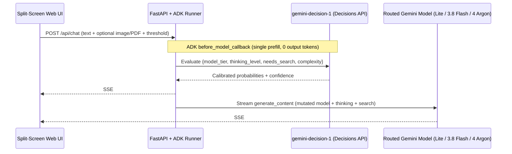

# Gemini Decision 1 — Dynamic Model Router Demo

A real-time multimodal model routing demo built with **Google Agent Development Kit (ADK)** and the **Gemini Decisions API (`gemini-decision-1`)**.

Instead of using a generative LLM to emit text routing labels, every user turn runs a **single prefill pass (`0 output tokens`)** on `gemini-decision-1` to evaluate **4 independent questions simultaneously**—dynamically routing across `gemini-3.5-flash-lite`, `gemini-3.8-flash`, and `gemini-4-argon` while streaming live probability bars, a 3-stage **Latency Waterfall**, and cumulative **cost savings vs. Always-Argon**.

---

## Architecture & Tech Stack



| Layer | Technology | Role |
| :--- | :--- | :--- |
| **Agent Runtime** | [Google ADK (`google-adk`)](https://adk.dev/) | `Agent` + `Runner` + `InMemorySessionService`; intercepts every turn via `before_model_callback` to mutate `llm_request.model` and `GenerateContentConfig` on the fly |
| **Decision Router** | `gemini-decision-1` (`v1beta/decisions`) | Single-prefill multimodal classifier returning calibrated probabilities across `choice`, `noul` (yes/no), and `score` questions with `0` output tokens |
| **Generative Tiers** | `gemini-3.5-flash-lite` · `gemini-3.8-flash` · `gemini-4-argon` | Fast extraction/translation → everyday engineering/synthesis → frontier proofs & deep systems reasoning |
| **Backend & Streaming** | Python 3.11+, FastAPI, `httpx` (HTTP/2), SSE | Streams Stage 1 routing telemetry immediately (~180–400 ms) before Stage 2/3 LLM generation completes |
| **Secret Management** | Google Cloud Secret Manager (ADC) | Loads the Gemini API key strictly in memory at runtime (`GEMINI_API_KEY` env var also supported for local quickstart) |
| **Frontend** | Zero-build HTML / CSS / Vanilla JS | Split-screen chat, Quick-Try task cards, multimodal attachment upload, confidence slider, and horizontal Latency Waterfall |

---

## Quick Start (Local)

### Prerequisites
* Python `3.11+` and [`uv`](https://docs.astral.sh/uv/)
* A [Gemini Developer API key](https://aistudio.google.com/apikey) (`generativelanguage.googleapis.com`)

### 1. Install Dependencies

```bash
uv sync
```

### 2. Configure Credentials

**Option A — Google Cloud Secret Manager (Recommended)**
Store your Gemini API key in Secret Manager (default secret name: `gemini_api_key`):

```bash
gcloud auth application-default login
gcloud auth application-default set-quota-project <YOUR_GCP_PROJECT_ID>

gcloud secrets create gemini_api_key --replication-policy=automatic --project=<YOUR_GCP_PROJECT_ID>
read -s -p "Paste GEMINI_API_KEY: " KEY && \
  printf "%s" "$KEY" | gcloud secrets versions add gemini_api_key --data-file=- --project=<YOUR_GCP_PROJECT_ID> && \
  unset KEY
```

*(If your secret uses a custom name or project, copy `.env.example` to `.env` and set `GOOGLE_CLOUD_PROJECT` and `GEMINI_API_KEY_SECRET_ID`.)*

**Option B — Local Environment Variable**
```bash
export GEMINI_API_KEY="your-gemini-api-key"
```

### 3. Run the Demo

```bash
uv run python -m app.demo_server
```

Open **http://localhost:8080** in your browser.

---

## Deploy to Google Cloud Run

Each browser tab generates an isolated `crypto.randomUUID()` `user_id` and `session_id` in memory, and per-request SSE telemetry is isolated via `contextvars.ContextVar`. For a zero-database multi-user deployment, deploy with `--max-instances=1` and `--session-affinity`:

```bash
export PROJECT_ID="<YOUR_GCP_PROJECT_ID>"
export REGION="us-central1"

# Grant the Cloud Run runtime service account read access to the secret
PROJECT_NUMBER=$(gcloud projects describe "$PROJECT_ID" --format="value(projectNumber)")
gcloud secrets add-iam-policy-binding gemini_api_key \
  --project="$PROJECT_ID" \
  --member="serviceAccount:${PROJECT_NUMBER}-compute@developer.gserviceaccount.com" \
  --role="roles/secretmanager.secretAccessor"

# Build and deploy from source
gcloud run deploy gemini-decision-router-demo \
  --source=. \
  --project="$PROJECT_ID" \
  --region="$REGION" \
  --max-instances=1 \
  --session-affinity \
  --concurrency=80 \
  --memory=1Gi \
  --timeout=300 \
  --set-env-vars="GOOGLE_CLOUD_PROJECT=${PROJECT_ID},GEMINI_API_KEY_SECRET_ID=gemini_api_key"
```

*(Tip: Add `--iap` to restrict access to authenticated users in your organization rather than exposing your API quota publicly.)*

---

## How to Use the Demo

1. **Quick-Try Task Cards (Top of Chat):** Click any of the 5 sample cards (*Simple Translation*, *Receipt Image OCR*, *Python Rate Limiter*, *Distributed Systems Proof*, or *Live Headlines & Weather*) to send real tasks (including an inline PNG receipt) and watch `gemini-decision-1` route each one live.
2. **Latency Waterfall (Above Each Assistant Reply):** Inspect the 3-segment timeline bar comparing **Decision 1 Routing (`ms`)** vs. **Model TTFT / Thinking (`ms`)** vs. **Streaming Decode (`ms`)**.
3. **Router Controls (Right HUD):**
   * **Confidence Escalation Slider:** Raise the threshold (e.g., to `0.85`) to see uncertain predictions automatically escalate one model tier higher.
   * **Routing Mode Selector:** Keep on `Auto (Gemini Decision 1)` or pin a single model to compare latency and response quality side-by-side.
   * **Dynamic Google Search Toggle:** Lets `gemini-decision-1`'s `needs_search` (`noul`) gate attach Google Search grounding only when fresh web facts are needed.

---

## Running Tests

```bash
uv run pytest tests/unit -v
```

## License

Apache 2.0 — see [LICENSE](LICENSE).
